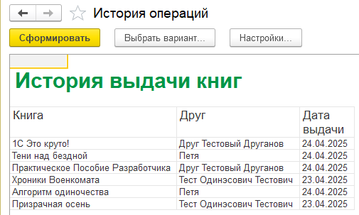
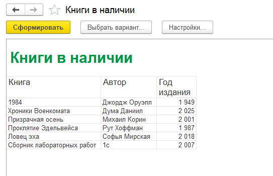
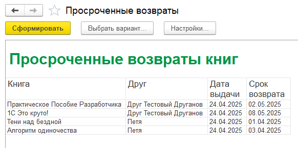

# 📚 HomeLib - «Домашняя библиотека»

Информационная система на платформе **1С:Предприятие 8.3** для учёта домашней библиотеки: какие книги есть, какие выданы друзьям, когда их нужно вернуть и у кого они задерживаются.

> 🎓 **Учебный проект.** Выполнен в рамках производственной практики (стажировки) в ООО «Гэндальф» в 2025г.

---

## О проекте

Конфигурация решает бытовую задачу: хозяин библиотеки одалживает книги друзьям и хочет в любой момент видеть:
- какие книги сейчас лежат на полке;
- кому и когда выдана каждая книга;
- какие возвраты просрочены;
- что с книгами происходило раньше.

## Возможности

- **Ведение справочников** книг, авторов и друзей.
- **Приход книг** в библиотеку.
- **Выдача книг другу** со сроком возврата для каждой книги.
- **Контроль остатков при проведении выдачи**: нельзя выдать книгу, которой нет в наличии.
- **Возврат книг** с проверкой, что каждая возвращаемая книга действительно была выдана именно этому другу; при нарушении проведение отменяется, а пользователю показывается, какие книги не прошли проверку.
- **Ввод возврата на основании выдачи**: табличная часть и друг заполняются автоматически.
- **Отборы в списке книг** по автору или жанру.
- **Обработка «Поиск книги»** с отбором по автору и жанру.
- **Четыре отчёта** на СКД (см. ниже).

## Модель данных

### Справочники

| Объект | Реквизиты |
|---|---|
| **Книги** | Название, Автор (ссылка на «Авторы»), Год издания (число), Жанр (строка) |
| **Авторы** | ФИО |
| **Друзья** | ФИО, Телефон |

### Документы

| Документ         | Шапка | Табличная часть «Книги» | Движения                              |
| ---------------- | ----- | ----------------------- | ------------------------------------- |
| **Приход книг**  | -     | Книга                   | Остатки книг (приход)                 |
| **Выдача книг**  | Друг  | Книга, Срок возврата    | Остатки книг (расход), История выдачи |
| **Возврат книг** | Друг  | Книга                   | Остатки книг (приход)                 |

### Регистры

| Регистр            | Вид                              | Назначение                                                                                                                 |
| ------------------ | -------------------------------- | -------------------------------------------------------------------------------------------------------------------------- |
| **Остатки книг**   | Накопления (остатки)             | Количество экземпляров каждой книги «на полке». Измерение - Книга, ресурс - Количество                                     |
| **История выдачи** | Сведений (подчинён регистратору) | Кто, какую книгу, когда взял и к какому сроку должен вернуть. Измерения/реквизиты: Книга, Друг, Дата выдачи, Срок возврата |

### Перечисление

**Реквизиты отбора** (Автор, Жанр) - используется формой списка книг для выбора поля отбора.

## Отчёты

| Отчёт                     | Что показывает                                                           |
| ------------------------- | ------------------------------------------------------------------------ |
| **Книги в наличии**       | Книги с положительным остатком: автор, год издания, количество           |
| **Выданные книги**        | Книги, которых сейчас нет на полке: кому выданы, когда и до какого срока |
| **Просроченные возвраты** | Выданные книги, у которых срок возврата меньше текущей даты              |
| **История операций**      | Журнал выдач: книга, друг, дата выдачи                                   |

## Интерфейс (подсистемы)

- **Учёт хранения** - книги, авторы, документы прихода/выдачи/возврата, остатки, поиск книги.
- **Работа с друзьями** — друзья, выдача и возврат, история выдачи, поиск книги.
- **Бухгалтерия** - документы, регистры и все отчёты.

## Скриншоты

